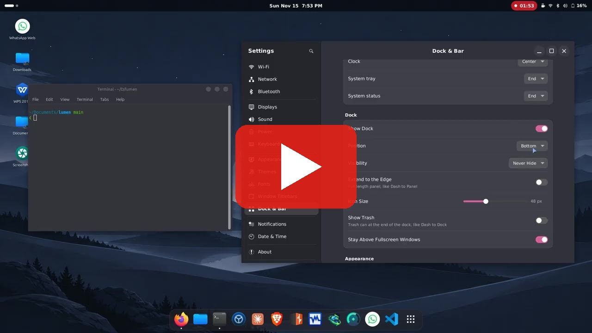

# Lumen Shell v0.5.0 — What's New

Binary: `lumen` (release, stripped). Source: `lumen-src.tar.gz` (`cargo build --release`, no extra crates).

<!-- When you get the user-attachments URL from https://github.com/Rocklinks/Lumen-Shell/issues/2,
     replace the line below with it (on its own line) to get the inline video player like JaKooLit's README -->

## What's New
- **Launcher**: an app pinned to the dock disappears from the grid (and from its folder) at once; unpinning brings it back.
  Works for right-click Pin/Unpin, drag to the dock, and the Pinned Apps page. A folder whose apps are all pinned closes.
  New-folder auto name follows GNOME's `_findBestFolderName`: first category all apps share, named like gnome-menus
  (Accessories, Programming, Universal Access, Sound & Video, ...), else "Unnamed Folder". Rename, drag-out ungroup,
  delete-on-last-app unchanged (they already matched GNOME).
- **Lumen Connect scan**: "Scan for Devices" row (Quick Settings > Lumen Connect, and Mobile Settings) shows a spinner and
  "Scanning for devices…" for 8 s, announces again after 3 s. Discovery now announces on *every* network (Wi-Fi, Ethernet,
  your PC's hotspot, a phone's hotspot) with directed broadcast + the default gateway, and re-announces within 3 s when a
  network appears. Before, one broadcast left via the default route only, so hotspot networks were missed.
- **Clipboard**: no `xclip`/`xsel`. Own X11 selection client in Rust (`clip.rs`). Texts up to ~200 KB. Wayland sessions
  use `wl-copy`/`wl-paste` when installed.
- **Settings**: sidebar is fixed (only the content scrolls). Rows with 3+ choices (Power Mode, Appearance Style, Sound
  connector) are GNOME dropdowns. "Change Background…" removed; click the wallpaper preview to pick a picture.
- **Dock & Bar**: Blur option and all blur code removed.
- **Settings icon**: colored theme icon first, then a built-in gear, then symbolic stand-ins, so it never vanishes.
  More Settings icon names are tried; themes installed while Lumen runs are re-read.

## Tested
`cargo test --workspace` under Xvfb: all pass (new: clipboard round trip + xclip interop, route/gateway parsing, built-in icon).
NOT tested on a real desktop: dropdown/preview click look, spinner look, pinned-hide while dragging, hotspot discovery
(needs a phone). If the Settings icon still shows a letter, tell me the icon theme name.
Firewall: allow UDP/TCP 1714-1764 for Lumen Connect.
